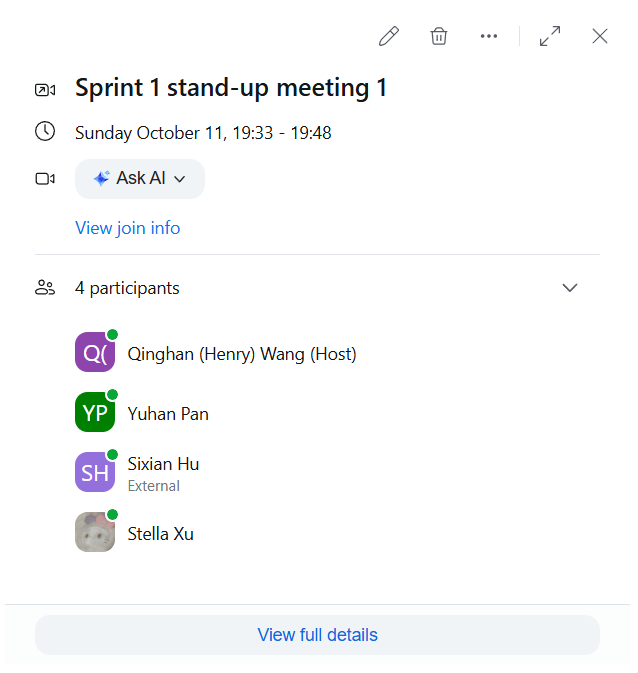
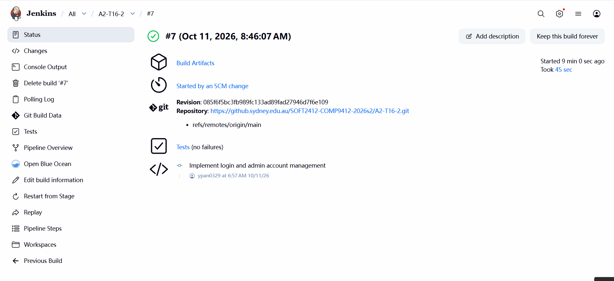

# Sprint 1 Stand-up Meeting 1

**Date:** 11 October 2026

**Time and duration:** 19:33-19:48 (15 minutes)

**Meeting type:** Online via Zoom

**Attendees:** Qinghan (Henry) Wang, Yuhan Pan, Sixian Hu, Stella Xu

**Sprint:** Sprint 1

## Progress Summary

The team reviewed Sprint 1 progress and confirmed completion of the following backend functionality:

- File-backed user and scroll storage.
- Password hashing and member registration.
- Scroll browsing and preview services.
- ID-key login and session management.
- Administrative account management.

A successful build was observed in Jenkins, providing CI evidence for the version checked by that build.

The full console workflow and application integration remain upcoming work.

## Upcoming Work

Upcoming development responsibilities are as follows:

| Member | Planned work |
|---|---|
| Stella Xu | Implement authenticated scroll upload and upload tests; verify the upload entry point and that uploaded scrolls appear in the list. |
| Sixian Hu | Implement download and persistent download counts after upload is merged; subsequently connect the browse, preview and download screens and add console tests. |
| Yuhan Pan | Review authentication integration; implement the role-aware console foundation and its tests, then connect the application entry point and add startup/restart tests. |
| Henry Wang | Review the console foundation; implement registration, initial administrator setup and administrator account-creation forms, including profile input and AccountConsoleTest; lead review of the application integration changes. |

Upload and download services will be completed first. Console changes will then be integrated in order: the console foundation, account forms, and scroll screens. Henry's account-form implementation depends on the console foundation being merged. All members will participate in full acceptance testing and demo preparation.

## Evidence

- Meeting attendance and time:

- Successful Jenkins build: #7, commit `085f6f5`.

