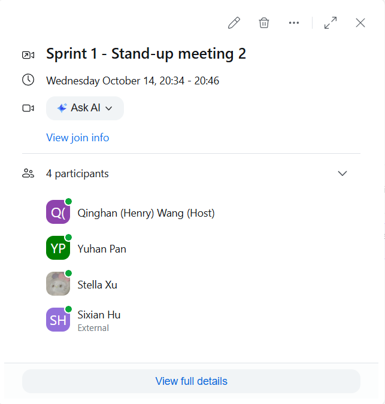

# Sprint 1 Stand-up Meeting 2

**Date:** 14 October 2026

**Time and duration:** 20:34-20:46 (12 minutes)

**Meeting type:** Online via Zoom

**Attendees:** Qinghan (Henry) Wang, Yuhan Pan, Stella Xu, Sixian Hu

**Sprint:** Sprint 1

## Progress Summary

The team shared the completion of all seven user stories selected for Sprint 1. Account registration, login, administrative account management, scroll upload, browsing, preview, and download functionality have been integrated into the main branch.

Jenkins build #14 successfully built commit `2572ae8` on main. All 93 tests passed, with no failures or skipped tests. The team agreed to freeze the Sprint 1 application code at commit `2572ae8`. Only documentation and supporting evidence will be added for the Sprint 1 submission.

## Questions for the Tutor

The team also discussed the following questions for the tutorial on 15 October 2026. The wording below follows the team's [Question for tutor - Sprint 1 issue (#14)](https://github.sydney.edu.au/SOFT2412-COMP9412-2026s2/A2-T16-2/issues/14).

### Question 1 — Expected Scope of the Preview Feature

Currently, our Preview feature displays basic scroll metadata, including the scroll ID, name, uploader ID, and upload date, without exposing the actual file content.

**Would you prefer the Preview feature to remain metadata-only, or would you like users to be able to preview part of the actual file content before downloading it?**

For example, we could provide a text preview for supported file types or display additional information such as file size, file type, and download count.

We would appreciate your feedback on what information would be most useful to users when deciding whether to download a scroll.

### Question 2 — Preserving Original File Formats During Download

Currently, our system reads uploaded files as raw binary data, stores that data, and writes the same bytes back to the user's chosen destination during download. This preserves the original file content, but users must manually specify the destination filename and extension.

As a result, a user could upload a `.pdf` file but accidentally save it with a `.txt` extension when downloading. Although the underlying content remains unchanged, the incorrect extension may cause confusion or prevent applications from opening the file correctly.

**We propose storing the original filename and file extension during upload, then automatically suggesting the same file format when downloading. Would you prefer this behaviour, or should users continue to have full control over the downloaded filename and extension?**

Our recommendation is to preserve the original file extension by default while allowing users to rename the file if needed. This would reduce user errors without restricting flexibility.

## Follow-up Actions

- Raise both questions with the tutor and record the responses in issue #14.
- Confirm whether the feedback requires changes to the user stories or acceptance criteria before implementing either proposal.

Both questions remain pending tutor clarification. Neither proposal was recorded as an agreed requirements change at this meeting.

## Evidence

- Meeting attendance and time:

