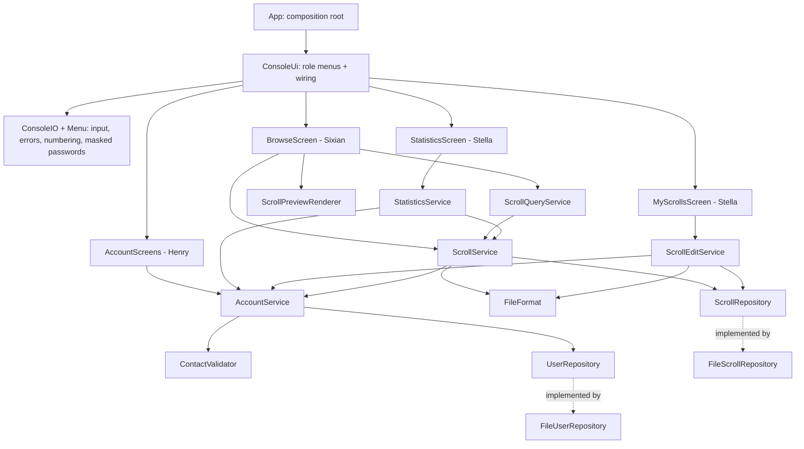
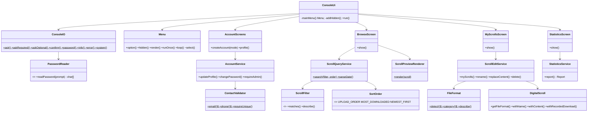
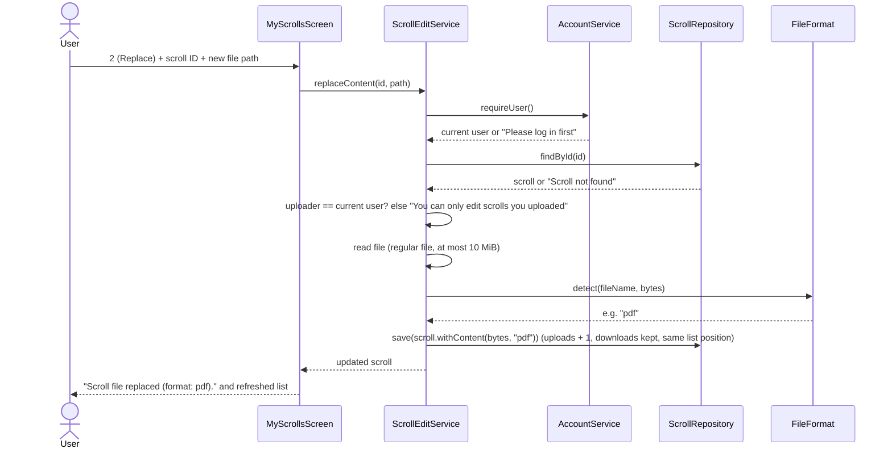

<!-- 主负责人：Yuhan（菜单集成，整理架构文档）；Henry、Stella、Sixian 核对各自模块。 -->
# Sprint 2 architecture and ownership

## Goal and boundaries

Extend the Sprint 1 terminal application with self-service account and scroll management,
discovery (filter/sort), format-aware previews, admin statistics and a consistent numbered CLI.
Ten stories, 38 points. The design keeps the Sprint 1 layering and adds **one class per feature
area** so that four people can work in parallel with almost no shared-file edits.

- `ui`: `ConsoleIO` is the only class touching `Scanner`/`PrintWriter`/`System.console()`. `Menu` renders
  `  1. Label … 0. Quit/Back`, parses numbers or Sprint 1 aliases, and turns expected exceptions into
  `Error: …` without leaving the menu. Screen classes contain no business rules.
- `service`: all rules (ownership, uniqueness, admin checks, validation, format detection). No console I/O.
- `repository`: storage contracts; `FileScrollRepository` now persists `format`, deletes, and replaces
  in place so list order stays stable.
- `model`: `DigitalScroll` stays immutable; `withName`, `withContent`, `withRecordedDownload` return copies.

## Class diagram (Sprint 2 additions in bold in the report figure)

## Responsibility mapping

| Owner | Stories | Implementation responsibility |
| --- | --- | --- |
| Henry (SM) | US03 #4, US16 #51 — 8 pts | ContactValidator, AccountService profile/password/uniqueness, user repository lookups, AccountScreens; CI coverage gate and Jenkins stages |
| Stella (PO) | US10 #11, US12 #13 — 8 pts | DigitalScroll/ScrollRepository/FileScrollRepository changes, ScrollEditService, StatisticsService, MyScrollsScreen, StatisticsScreen; README |
| Yuhan | US13 #48, US14 #49, US15 #50 — 10 pts | ConsoleIO, Menu, PasswordReader, Validation messages, ConsoleUi, App |
| Sixian | US06 #7, US17 #52, US18 #53 — 12 pts | FileFormat, ScrollFilter, SortOrder, ScrollQueryService, ScrollPreviewRenderer, ScrollService upload/download changes, BrowseScreen |

Owner comments are assignments for maintenance and explanation, not authorship claims.

## Representative sequence: replace a scroll's file (US10 + US17 + US12)

## Decisions and practical limits

1. **Numbering is stable across roles.** Browse is always 1 and Quit always 0; member and admin share 1–5;
   admin-only items are 6–9. In sub-screens, options that need login stay visible (marked
   "(log in required)") so numbers never shift; the service layer rejects guests.
2. **Sprint 1 command words remain as hidden aliases** (`browse`, `preview s1`, …) so existing scripts,
   tests and habits still work. Permissions are always enforced by services, not by hiding.
3. **Invalid input never ends the program.** Blank required fields are re-asked immediately; invalid
   menu choices show the valid range; business errors print `Error: …` and keep the user on the same menu.
4. **Masked passwords** use `System.console().readPassword`. Gradle `run` and IDEs have no console, so
   the program warns that input is visible. Demos should use `app/build/install/app/bin/app`.
5. **Uniqueness**: email compared case-insensitively and stored in lowercase; phone compared after removing
   spaces, `-`, `(`, `)`, `.`. Applies to registration, admin creation and profile updates. Existing data with
   duplicates is not rewritten.
6. **Ownership**: only the uploader can rename, replace or delete a scroll — admins included, following the
   assignment wording. Deleting a user keeps their scrolls (Sprint 1 decision).
7. **Upload count** means “times content was uploaded”: 1 at creation, +1 on each file replacement.
   Browsing, previewing, filtering and sorting never change counters.
8. **Format** is the lowercase extension of the uploaded file; without one, magic numbers (PDF, PNG, JPG, GIF,
   ZIP) or UTF-8 text detection are used; otherwise `unknown`. Download appends the extension if the chosen
   path lacks it; `unknown` never renames. Previews read bytes only — nothing is executed or extracted.
9. **Filtering** uses case-insensitive “contains” for IDs and names, exact day for dates, AND for combinations.
   Sorting by downloads is descending with newest-first tie-break.
10. Storage limits from Sprint 1 still apply (single process, whole snapshot in memory, 10 MiB per scroll).
