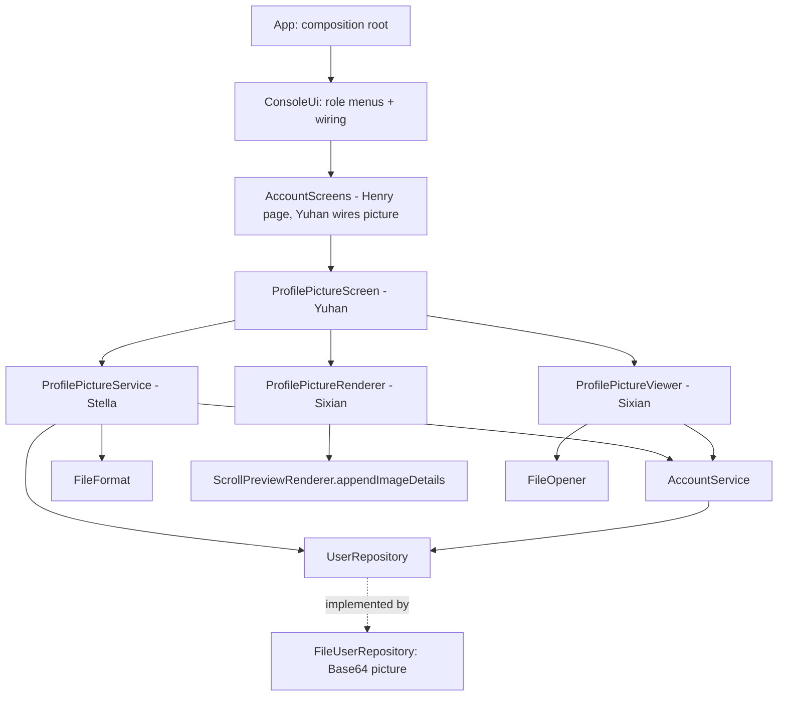
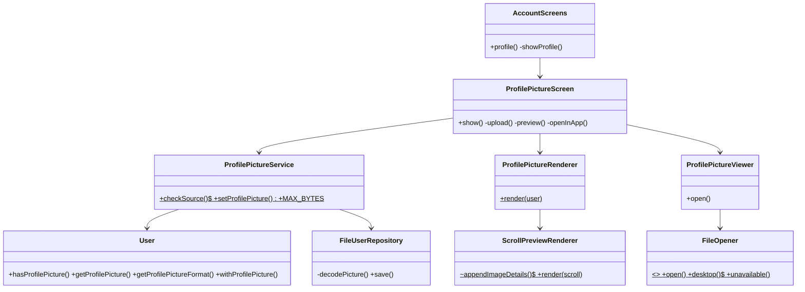

<!-- 主负责人：Yuhan（界面集成，整理架构文档）；Henry、Stella、Sixian 核对各自模块。 -->
# Sprint 3 architecture and ownership

## Goal and boundaries

Add a personal profile picture to each account. A logged-in user uploads a JPG/PNG from "My profile"
(validated by both extension and real content), the picture is stored with the account (Base64),
and the user can preview it exactly like an image scroll and open it in the default application.
Two stories, 13 points. The design keeps the Sprint 1/2 layering and adds **new service and screen
classes per feature** so that four people work in parallel with almost no shared-file edits. The only
shared files touched are `User`/`FileUserRepository` (Henry), `ScrollPreviewRenderer` (Sixian, same
original author), and the wiring files `AccountScreens`/`ConsoleUi`/`App` (Yuhan). The 2026-10-24 corrective audit also
updates `AccountService.updateProfile/changePassword` (P1 maintenance, Henry) to preserve avatar fields.



- `model`: `User` stays immutable; two optional fields (`profilePicture`, `profilePictureFormat`) default to
  "no picture". The 7-arg Sprint 1 constructor delegates to the 9-arg one for new accounts;
  existing-account updates use all nine fields to preserve the picture.
- `repository`: `FileUserRepository` stores the picture as Base64 inside the user snapshot; snapshots without the
  `picture`/`picformat` keys load as "no picture" (backward compatible).
- `service`: all rules live here. `ProfilePictureService` validates (extension + content magic number + strict image decoding/integrity + size +
  login) and saves; `ProfilePictureRenderer` reuses the image preview; `ProfilePictureViewer` reuses `FileOpener`.
- `ui`: `ProfilePictureScreen` collects input, retries content/read errors and prints results; it is reached from `AccountScreens.profile`.

## Class diagram (Sprint 3 additions)



## Responsibility mapping

| Owner | Story (part) | Implementation responsibility |
| --- | --- | --- |
| Henry (SM) | US19 #67 — model/storage (~4 pts) | `User` picture fields + `withProfilePicture`; `FileUserRepository` Base64 persistence and backward compatibility; CI gate |
| Stella (PO) | US19 #67 — validation (~4 pts) | `ProfilePictureService`: `checkSource`, `setProfilePicture` (extension + content + size + login + replace); README |
| Sixian | US20 #68 — preview/open (~5 pts) | `ProfilePictureRenderer`, `ProfilePictureViewer`; extract `ScrollPreviewRenderer.appendImageDetails` |
| Yuhan | US19 + US20 — UI (~5 pts) | `ProfilePictureScreen`; wire into `AccountScreens`, `ConsoleUi`, `App` |

Owner comments are assignments for maintenance and explanation, not authorship claims.

## Representative sequence: upload then preview a profile picture (US19 + US20)

```mermaid
sequenceDiagram
    actor User
    participant UI as ProfilePictureScreen
    participant P as ProfilePictureService
    participant A as AccountService
    participant R as UserRepository
    participant F as FileFormat
    participant RN as ProfilePictureRenderer
    User->>UI: 1 (Upload) + picture path
    UI->>P: checkSource(path) (extension, size)
    P-->>UI: validated Path
    UI->>P: setProfilePicture(path) (also rechecks extension/size)
    P->>A: requireUser()
    A-->>P: current user or "Please log in first"
    P->>F: detect(null, bytes)  (content magic number)
    F-->>P: "png" / "jpg" or reject fake image
    P->>P: decode pixels; reject warnings; verify PNG chunks/CRCs/IEND
    P->>R: save(user.withProfilePicture(bytes, "png"))
    P-->>UI: updated user
    User->>UI: 2 (Preview)
    UI->>RN: render(user)
    RN-->>UI: Format / Size / Image size: W x H pixels
```

## Decisions and practical limits

1. **Optional, backward-compatible model.** The picture is an optional field; the Sprint 1 constructor still works,
   and snapshots written before Sprint 3 load as "no picture". No Sprint 1/2 behaviour changes.
2. **Validate by extension AND content.** `checkSource` checks the extension (jpg/jpeg/png) and size early;
   `setProfilePicture` repeats `checkSource` for direct callers, then uses `FileFormat.detect` plus full pixel decoding,
   rejects decoder warnings, and validates PNG chunk lengths/CRCs/IEND. A decodable PNG under `.txt` is also rejected.
3. **5 MiB limit.** Avatars are small, so the limit is half the 10 MiB scroll limit.
4. **Reuse, don't duplicate.** Preview reuses the image rendering (`appendImageDetails`) and opening reuses `FileOpener`,
   keeping the avatar experience identical to image scrolls and avoiding new preview/open logic.
5. **No counters touched.** Previewing or opening a picture never saves a scroll or account, so no download/upload
   count changes. Guests cannot upload or preview (service-layer `requireUser`).
6. **New files per feature.** Service and screen are new classes; shared edits cover the account model/storage
   and corrective account preservation (Henry), the extracted image helper (Sixian, same author) and the wiring files (Yuhan).

## Corrective maintenance — 2026-10-24

The original 2026-10-22 tests missed account reconstruction, corrupt-image integrity, direct-service
extension checks and retry after content errors. Both persistence failures arose from the same
seven-argument `User` reconstruction in `AccountService`, not from Base64 serialization. The full
constructor now preserves the picture during both profile and password updates. `User` and
`FileUserRepository` require no schema or implementation change; older snapshots remain compatible.
P1/Henry owns this account preservation correction; P2/Stella owns `canDecode`/`hasValidPngChunks`
and service validation; P4/Yuhan owns immediate retry and the separate-process lifecycle tests.
These are corrections within the existing four tasks/four rounds. See the dated
[validation record](validation.md) for all construction/save paths and current test evidence.
